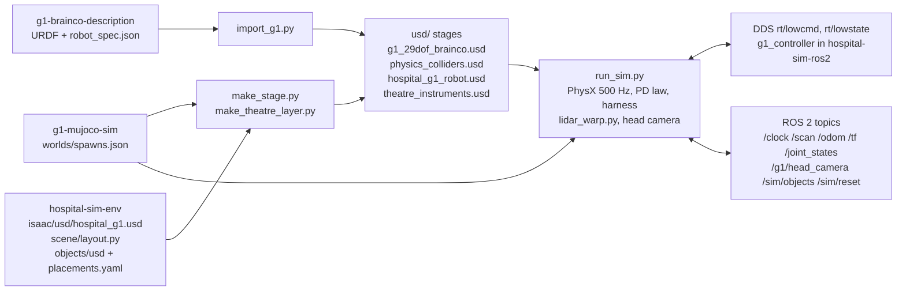

# g1-isaac-sim: G1 in the Isaac hospital, speaking lowcmd/lowstate

This repository is the Isaac Sim 6.0 backend of the G1 stack. It puts the G1 29-DoF rev 1.0 with BrainCo Revo2
hands in the Isaac hospital. The robot speaks the same low-level interface as the real robot and as the MuJoCo
backend in `g1-mujoco-sim`. This interface is `/lowcmd`, `/lowstate`, `/clock`, `/odom`, `/scan` and the hand
topics. The ROS 2 stack in `hospital-sim-ros2` (controller, mode manager, keyboard, UI, Nav2) therefore runs on top
with `backend:=isaac` and no other change.

The repository reads from three sibling repositories:

- `g1-brainco-description` provides the URDF and `robot_spec.json`.
- `hospital-sim-env` provides the scene, the room layout, the instruments and their placements.
- `g1-mujoco-sim` provides the shared spawn poses in `worlds/spawns.json`.

The master repository `hospital-sim` checks all of them out side by side, and `env.sh` is in its root.

Paths in this file are relative to this folder unless they start with a sibling repository name
(`hospital-sim-env/...`, `g1-brainco-description/...`, `g1-mujoco-sim/...`). The paths `docs/interfaces.md` and
`env.sh` are in the master repository root. Run the commands from the master repository root
(`./g1-isaac-sim/run.sh ...`).

This repository does not modify `hospital-sim-env/isaac/` (`scene/`, `usd/`, `assets/`) or
`hospital-sim-env/objects/`. It adds USD layers that sublayer or reference them.

## How it works

Two generators build the committed stages in `usd/` offline. The script `import_g1.py` runs in Isaac's Python. It
imports the URDF from `g1-brainco-description` with the URDF importer of Isaac 6.0 and moves the articulation root
to `pelvis`. It puts every revolute joint in force mode with zero stiffness and damping. It sets the armature and
the effort limits from `robot_spec.json`. It checks the 29 contract joints and writes `usd/g1_29dof_brainco.usd`
plus `joints.json`.

The script `make_stage.py` uses plain `usd-core` and does not need Isaac. It writes `usd/physics_colliders.usd`.
At tier2 this layer holds these items:

- a `PhysicsScene` at 500 Hz;
- 4 floor slabs: the wing, the hospital footprint (with the courtyard and the A&E apron), the wing lift lobby
  and the exit path;
- 27 wing walls from the rooms and `PARTITIONS` of `hospital-sim-env/isaac/scene/layout.py`, with the doorways
  open (the 4 m link and the 10 m PACU included);
- 87 static partitions of the main building (`hospital_fixtures.static_partitions()`): 48 screen pieces, 30
  rebuilt-wall pieces, 4 vision-panel glass boxes and 5 link junction boxes;
- 19 exterior boxes (`layout.EXTERIOR_COLLIDERS`): drive floor, footway and ramp, 10 kerbs, canopy and sign
  posts, ambulance;
- 106 furniture boxes around dressing items that have no collider of their own.

The script adds these colliders to the `Static` collision group of the fixtures layer, so the door leaves and lift
panels do not collide with the walls they hinge on. It also deactivates the building prims of
`hospital_fixtures.building_hide()` for the tier (248 at tier2). At tier2 and full it also removes the
main-entrance glass, so the walk-in route is open. A deactivated prim drops its triangle-mesh colliders too. The script also writes the root stages. These
stages sublayer the physics layer with `hospital-sim-env/isaac/usd/hospital_g1.usd` and reference the robot at the
default spawn. The script `make_theatre_layer.py` adds the instrument layer from
`hospital-sim-env/objects/placements.yaml`.

At runtime, the script `run.sh` runs `~/isaacsim/python.sh` with a scrubbed environment. This environment puts the
ROS 2 Humble libraries that Isaac bundles on `LD_LIBRARY_PATH`, sets `RMW_IMPLEMENTATION=rmw_cyclonedds_cpp` and
sets `PYTHONPATH=pydeps`. The folder `pydeps/` holds CycloneDDS and `unitree_sdk2py`, which `setup_deps.sh` builds
once. The script `run_sim.py` opens the stage, places the robot at the spawn and freezes the Lightwheel props into
static colliders. It keeps the fixtures under `/World/Fixtures` dynamic. It applies the Revo2 fixes from `hand_physics.py` in the
session layer. It initialises PhysX on
the CPU with dt 2 ms, then disables `isaacsim.core.simulation_manager`, because its per-step hook traverses the
whole stage.

The script `run_sim.py` creates the ROS 2 node with Isaac's rclpy first. It then creates a CycloneDDS participant
on `ROS_DOMAIN_ID` with a writer on `rt/lowstate` and readers on `rt/lowcmd` and `rt/g1/mode`.

The main loop runs one step every 2 ms. Each step reads the joint positions and velocities through the tensor API.
It takes the latest `/lowcmd`, or the `--idle` law before the first one. It computes
`tau = kp (q* - q) + kd (dq* - dq) + tau_ff`, clips the result to the motor limit and applies it as joint effort.
The hand joints get position targets from `/g1/hand/*/cmd`. The virtual harness adds a pelvis force while
`/g1/mode` is DAMP. Then `fixtures_isaac.py` steps the fire doors and the bed lifts (see "Fire doors and bed
lifts" below).

The loop then calls `simulate(0.002)` and reads the pelvis pose and velocity. It builds the IMU (quaternion wxyz,
body-frame gyro and accel, rpy). It serialises `/lowstate` with the numpy CDR writer in `fast_lowstate.py`, with
the tick in ms and the CRC filled, and publishes `/clock`.

The loop publishes the slower topics at fixed step counts:

- Every 5 steps (100 Hz), it publishes `/joint_states`, `/odom`, `/tf odom->pelvis` and `/sim/ground_truth`.
- Every 20 steps, it publishes the hand states.
- Every 50 steps (10 Hz), `lidar_warp.py` ray-casts a MID-360 pattern and a 720-beam planar scan. The pattern
  has 25 rings x 400 azimuths and up to 10 000 points. The rays hit a Warp BVH of the static colliders and a
  second small BVH of every moving fixture (door leaves of `Doors` and `Doors1`, lift panels, button caps: 44
  boxes at tier2, 52 at full, 12 triangles each). Before each scan, the second BVH is refitted to the current
  fixture pose when a box moved, and each ray keeps the nearer hit. The results go out on
  `/livox/lidar` and `/scan`.
- Every 50 steps (10 Hz), `/sim/fixtures` reports the fixture state.
- Once per second, `/sim/status` reports the rtf and the step time.

With `--camera`, an RTX render and a replicator readback produce `/g1/head_camera/{image_raw,depth,camera_info}`.
With `--theatre`, the instrument poses go out on `/sim/objects` at 20 Hz. The loop is paced to the wall clock
unless `--no-realtime` is set.

## Fire doors and bed lifts

The fixtures cover the whole hospital: the fire doorsets of the surgical wing and of the main building, two banks of
bed lifts, and their call and car buttons. The data and the UK guidance behind it are in
`hospital-sim-env/isaac/scene/layout.py` (`FIRE_DOORS`, `BUILDING_FIRE_DOORS`, `LIFTS`, `BUILDING_LIFTS`,
`LIFT_BANKS`, `LIFT_SPEC`, `LIFT_CALL`, `BUILDING_LIFT_CALL`). The behaviour is in
`hospital-sim-env/fixtures/hospital_fixtures.py`. The MuJoCo backend runs the same `FixtureController`, so the two
simulators behave the same.

### Fixture tier

The tier sets how many fixtures the simulation has (CPU budget). Use the same tier for every part: the scene build,
the stages, the run time and MuJoCo.

| Tier | Contents | Doors | Doors1 | Lifts | Calls | Joints |
|---|---|---|---|---|---|---|
| `wing` | surgical wing only | 7 | 0 | 2 | 1 | 23 |
| `tier1` | + W/E_Compartment, W/E_Stair, main lift bank, MainCall | 9 | 2 | 4 | 2 | 38 |
| `tier2` (default) | + Main_LiftLobby, D07_Exit, D34_Exit | 12 | 2 | 4 | 2 | 44 |
| `full` | + 8 FD30S hazard-room doors | 12 | 10 | 4 | 2 | 52 |

To set the tier, do these steps:

1. Build the scene: `cd hospital-sim-env/isaac && HG1_FIXTURES=full uv run --no-project --with usd-core python
   scene/build_hospital.py`.
2. Build the stages: `./g1-isaac-sim/run.sh --fixtures full --stage`.
3. Run: `./g1-isaac-sim/run.sh --fixtures full --headless`.
4. For MuJoCo, use the same tier: `fixtures_tier:=full` (see `g1-mujoco-sim/README.md`).

`run.sh --fixtures TIER` exports `HG1_FIXTURES`. The layer `fixtures.usd` records its tier in the customData
`hg1:tier` of `/World/Fixtures`. The run time always uses the tier of the stage. If `HG1_FIXTURES` is different,
`run_sim.py` writes a warning: rebuild the stages. At `tier2`, the 8 hazard-room doorways keep the closed static
leaves of the asset (with their colliders). These leaves keep the pose of the asset, so some stand ajar or open
(for example `Ward_Cleaners`). At `full`, these leaves are hidden and the FD30S doorsets replace them. Below
tier2, D07 and D34 also keep their closed asset doors, and the main-entrance glass stays solid. From tier2 up, the
main-entrance glass is removed in both simulators.

### Articulations

The layer `hospital-sim-env/isaac/usd/fixtures.usd` holds one articulation per doorset, lift and call button under
`/World/Fixtures`. There is one tensor-view group per spec group (`spec["groups"]`). All the articulations in a
group have the same links and joints, so each group is one homogeneous view:

| Group | Count (tier2 / full) | Structure |
|---|---|---|
| `Doors/*` | 12 / 12: the 7 wing doors, W_Compartment, E_Compartment, Main_LiftLobby, D07_Exit, D34_Exit | `Base` fixed to the world, `Leaf0` and `Leaf1` on revolute joints about +z (2 DOF) |
| `Doors1/*` | 2 / 10: W_Stair, E_Stair (+ AE_DirtyUtility, AE_CleanLinen, Central_Store, Pharmacy1, Pharmacy2, Ward_Cleaners, Ward_CleanLinen, Ward_DirtyUtility) | `Base`, `Leaf0` on a revolute joint (1 DOF) |
| `Lifts/*` | 4: Lift1, Lift2 (wing bank), MainLift1, MainLift2 (main bank) | `Base`, `PanelA` and `PanelB` on prismatic joints, `BtnOpen` and `BtnClose` on prismatic joints (4 DOF) |
| `Calls/*` | 2: LobbyCall (wing bank), MainCall (main bank) | `Base`, `Btn` on a prismatic joint (1 DOF) |

The joints have no drives. PhysX batches only articulations with the same link and joint names, so the joint prims
have generic names (`fx_leaf0`, `fx_door_a`, `fx_Open`, `fx_button`). The spec joint name
(`fx_CrossCorridor_leaf0`) is in the customData `hg1:joint` of each joint prim. Each physics step,
`fixtures_isaac.py` does these steps:

1. It reads the DOF positions and velocities of the four views.
2. Every 5 steps, it casts the light-curtain rays of each lift (both banks) that is not closed (`curtain_rays()`,
   8 PhysX scene-query rays across the gap between the panels).
3. It calls `FixtureController.step(dt, q, qd, curtain_blocked)`.
4. It writes the returned efforts with `set_dof_actuation_forces` (N m for hinges, N for slides).

The step costs about 0.2 ms with the robot loop (0.32 ms mean, 0.58 ms p99 in `tools/fixtures_test.py`), at tier2
and at full. At start and on `/sim/reset`, the fixtures go to `initial_q()`. The held doors are then open at
+-90 deg on their magnets (Compartment, CrossCorridor, LiftLobby, Theatre, W_Compartment, E_Compartment,
Main_LiftLobby). The other doors and the lifts are closed. A kept-shut leaf opens when pushed and its closer shuts
it again. The stair doors are never held open. The lift-call services answer `success=False` while the fire alarm
is on: the lifts are on fire recall and ignore the call. The MuJoCo backend gives the same answer.

Main-building doors in the openings of the new screens have no transom: the screen head piece (from z 2.12 m) is
there. Doors in the asset's own door frames (hazard rooms, D07, D34) have leaf visuals that fill the measured
frame hole. Their colliders keep the spec size. The frames and the 25 mm thresholds of the hazard-room doors are
in the `Static` collision group. Without this, the thresholds hold the leaves shut (see `docs/design_notes.md`).

Buttons are rigid bodies with colliders, so a finger can push them. A button triggers when it moves in more than
2.5 mm, which needs about 4.1 N. The ROS 2 interface is the same in both simulators:

| Name | Type | Direction | Meaning |
|---|---|---|---|
| `/sim/fire_alarm` | std_msgs/Bool | in | true releases every hold-open magnet (one building-wide alarm) and puts all the lifts on fire recall |
| `/sim/fixtures/press` | std_msgs/String | in | virtual press of a button by short name: `LobbyCall`, `MainCall`, `<lift>_Open`, `<lift>_Close` for `Lift1`, `Lift2`, `MainLift1`, `MainLift2`. An unknown name is logged and ignored |
| `/sim/lift/call` | std_srvs/Trigger | service | same as pressing `LobbyCall` (wing bank); `success` is false during the fire alarm (calls are ignored) |
| `/sim/lift/call_main` | std_srvs/Trigger | service | same as pressing `MainCall` (main bank); `success` is false during the fire alarm, or when the tier has no main bank (`wing`) |
| `/sim/fixtures` | std_msgs/String (JSON) | out, 10 Hz | `FixtureController.state_json()`: sim time, alarm, per door (every door of the tier) the leaf angles in deg, `closed`, `held_open`; per lift `state`, `door_gap_m`, `reopens`, `nudging`, `dwell_left_s`; the last 5 events |

The topics use the default QoS (reliable, volatile, depth 10). The option `--fixture-control off` leaves the
fixtures without control (debug).

## Architecture



The table below lists the main pieces of this repository.

| Piece | File | Role |
|---|---|---|
| Launcher | `run.sh` | Environment for Isaac's python (Humble libs, RMW, `pydeps`), dispatches `--headless`, `--gui`, `--import`, `--stage`, `--stills`, `--python` |
| DDS deps | `setup_deps.sh` | Builds the CycloneDDS 0.10.5 binding and copies `unitree_sdk2py` into `pydeps/` (run once by `run.sh`) |
| URDF import | `import_g1.py` | URDF -> `usd/g1_29dof_brainco.usd` + `joints.json`, articulation root on `pelvis`, effort-mode drives |
| Physics layer and roots | `make_stage.py` | `usd/physics_colliders.usd`, `usd/hospital_g1_robot.usd`, `usd/flat_g1_robot.usd`, `usd/physics_colliders.json` |
| Theatre layer | `make_theatre_layer.py` | `usd/theatre_instruments.usd`, `usd/hospital_g1_theatre.usd`, `usd/flat_theatre_robot.usd` |
| Simulator and bridge | `run_sim.py` | Main loop: PD torques, harness, PhysX step, `/lowstate`, ROS 2 topics, lidar, camera, `/sim/*` services |
| Lidar | `lidar_warp.py` | MID-360 cloud and 2-D scan by Warp ray casting against a snapshot of the static colliders and the moving fixture boxes |
| Fixtures | `fixtures_isaac.py` | Fire doors, bed lifts and buttons: tensor views, `FixtureController`, light curtain, reset |
| Lowstate writer | `fast_lowstate.py` | numpy CDR serialiser for `rt/lowstate`, self-tested against the cyclonedds serialiser at start-up |
| Extra DDS types | `dds_types.py` | `g1_interfaces/Mode` on the wire (`rt/g1/mode`) for the harness release |
| Constants | `g1_config.py` | Joint order, default pose, gains, torque limits, spawns; reads `robot_spec.json` and `spawns.json` |
| Hand physics | `hand_physics.py` | Revo2 mass and inertia floors, colliders, solver iterations (session-layer overrides) |
| Stills | `render_stills.py` | RTX stills of the robot in the hospital -> `renders/` |
| Checks and tools | `tools/` | Hold test, route check, grasp and rack tests, topic check, relay, e-stop stub, camera replay, VRAM scripts |

## Dependencies

This repository has no `requirements.txt` on purpose. Every Python package comes from Isaac Sim's own Python
(3.12.13) or from `pydeps/`, which `setup_deps.sh` builds into this folder. Only the ROS 2 client tools in `tools/`
use the shared `.venv`.

### System

The table below lists the system components and their versions on this machine.

| Component | Version here | Notes |
|---|---|---|
| Ubuntu | 22.04.5 | |
| NVIDIA Isaac Sim | 6.0.0-rc.59 at `~/isaacsim` (`ISAAC_DIR` overrides) | Brings python 3.12.13, PhysX, RTX, OpenUSD, the URDF importer, `omni.warp.core` 1.13.0 and a ROS 2 Humble library set in `exts/isaacsim.ros2.core/humble` (rclpy, message packages, `libddsc.so.0.10.5`, `librmw_cyclonedds_cpp.so`) |
| GPU | NVIDIA GeForce RTX 3070, 8 GB, driver 580.178.04 | Headless without a camera needs 1.3-1.6 GB of VRAM; anything that renders the hospital needs about 5 GB free. The lite asset mirror of `hospital-sim-env` is required on 8 GB (see `docs/measurements.md`) |
| ROS 2 Humble | `ros-humble-cyclonedds` 0.10.5, `ros-humble-rmw-cyclonedds-cpp` 1.3.5 | `setup_deps.sh` builds against `/opt/ros/humble` headers and `libddsc`. `.venv` tools also need `ros-humble-rosbag2*` and the `hospital-sim-ros2` overlay (`unitree_hg`, `g1_mujoco_sim`) |
| `uv` | 0.12.19 | Runs `make_stage.py`, `make_theatre_layer.py` and the offline tools with `--with usd-core` (no Isaac) |
| git | | `setup_deps.sh` clones `unitree_sdk2_python` |

### Python

The command `grep -rhoE "^(import|from) [a-zA-Z_][a-zA-Z0-9_.]*" --include=*.py .` lists the imports. The table
below excludes the standard library and this repository's own modules. The versions come from the installed
package metadata. No package here is in a freeze file, because none of them is installed into a venv.

| Package | Version | Comes from | Used by |
|---|---|---|---|
| `isaacsim`, `omni.*`, `carb`, `pxr` | Isaac Sim 6.0.0-rc.59 | Isaac install | `run_sim.py`, `import_g1.py`, `render_stills.py`, Isaac tools |
| `numpy` | 2.3.1 | Isaac (`omni.kit.pip_archive`) | everything |
| `warp` | 1.13.0 | Isaac extension `omni.warp.core` | `lidar_warp.py`; offline tools use `warp-lang` through `uv` (1.17.0 / 1.18.0 in the uv cache) |
| `yaml` (PyYAML) | 6.0.3 | Isaac (`omni.pip.compute`); `uv --with pyyaml` for `make_theatre_layer.py` | `run_sim.py` (`--spawn` stance lookup), `make_theatre_layer.py` |
| `PIL` (Pillow) | 12.1.1 | Isaac (`omni.kit.pip_archive`) | `render_stills.py`, `tools/replay_camera.py`, `tools/rack_settle_test.py` |
| `cyclonedds` | 0.10.5 | `pydeps/`, built by `setup_deps.sh` against `/opt/ros/humble` `libddsc` 0.10.5 | `run_sim.py`, `dds_types.py`, `fast_lowstate.py` |
| `unitree_sdk2py` | commit `814556d15970dd2ecf1c9984e845ca02ab07e206` (`pydeps/UNITREE_SDK2PY_VERSION`) | `pydeps/`, copied by `setup_deps.sh` from `unitreerobotics/unitree_sdk2_python` | `run_sim.py` (IDL types, CRC), `fast_lowstate.py` |
| `rclpy`, `builtin_interfaces`, `geometry_msgs`, `nav_msgs`, `rosgraph_msgs`, `sensor_msgs`, `std_msgs`, `std_srvs`, `tf2_msgs` | Humble | Isaac `exts/isaacsim.ros2.core/humble` (sim process); system `/opt/ros/humble` (tools) | `run_sim.py`; `tools/*.py` ROS clients |
| `usd-core` | 26.8 (uv cache) | `uv run --with usd-core` | `make_stage.py`, `make_theatre_layer.py`, `tools/check_routes.py`, `tools/rasterize_colliders.py` |

The shared `.venv` has `cyclonedds==0.10.2`, but this backend does not use it. The `.venv` tools are
`tools/lowcmd_hold_test.py`, `tools/theatre_topics_check.py`, `tools/isaac_relay.py`, `tools/estop_stub.py` and
`tools/extract_traj.py`. They use these packages:

- `numpy==1.26.4` from the venv freeze;
- `rclpy` and `rosbag2_py` from the ROS apt packages;
- Pillow from Ubuntu `python3-pil` 9.0.1;
- `unitree_hg` from `ros2_ws/src/hospital-sim-ros2/third_party/unitree_ros2`;
- `g1_mujoco_sim.stubs` from the `ros2_ws` overlay.

### Data and assets not in git

The table below lists the data and assets that are not in git.

| Asset | Where it comes from |
|---|---|
| Isaac Sim 6.0 asset pack (hospital building) | `~/isaacsim_assets/Assets/Isaac/6.0`; fetched with NVIDIA's tooling, see `hospital-sim-env/README.md` |
| Isaac for Healthcare (i4h) sim-ready catalog 0.7.0 | `~/isaacsim_assets/Assets/Isaac/Healthcare/0.7.0/724f82e`; the `hospital-sim-env/isaac/assets/{isaac,i4h}` symlinks must point at it (or at the lite mirror `~/isaacsim_assets/lite/...`, `hospital-sim-env/isaac/scene/select_assets.py lite`) |
| `unitree_sdk2_python` source | cloned by `setup_deps.sh` into `$TMPDIR/hg1_isaac_deps`, copied to `pydeps/` (gitignored) |
| `pydeps/` | built by `setup_deps.sh`, gitignored |

This repository needs no trained policy and no dataset.

## Install

Start from a fresh clone of the master repository (`git clone https://github.com/Bkrakshith/hospital-sim.git Hospital_G1 && cd
Hospital_G1 && vcs import < hospital-sim.repos`). Then run these steps in order:

```bash
# 1. Isaac Sim 6.0 installed at ~/isaacsim (or export ISAAC_DIR=/path/to/isaacsim).
# 2. ROS 2 Humble with CycloneDDS (the system packages setup_deps.sh builds against)
sudo apt install ros-humble-cyclonedds ros-humble-rmw-cyclonedds-cpp
# 3. Isaac assets: point hospital-sim-env/isaac/assets/{isaac,i4h} at your copies; use the lite mirror on 8 GB
#    (hospital-sim-env/isaac/README.md, "Fitting an 8 GB GPU")
python hospital-sim-env/isaac/scene/select_assets.py lite
# 4. DDS deps for Isaac's python (CycloneDDS 0.10.5 binding + unitree_sdk2py -> g1-isaac-sim/pydeps). run.sh
#    runs this itself when pydeps/ is missing.
./g1-isaac-sim/setup_deps.sh
# 5. For the ROS 2 client tools and the stack on top (unitree_hg messages, g1_mujoco_sim stubs):
source env.sh && (cd ros2_ws && colcon build --symlink-install) && source env.sh
```

The tool `uv` (0.12.19 here, `curl -LsSf https://astral.sh/uv/install.sh | sh`) is needed only for `run.sh --stage`
and the offline tools. The stages in `usd/` are committed. Regenerate them only after a change to the URDF,
`layout.py`, `placements.yaml` or the generators:

```bash
./g1-isaac-sim/run.sh --import     # URDF -> usd/g1_29dof_brainco.usd (Isaac python, headless)
./g1-isaac-sim/run.sh --stage      # make_stage.py then make_theatre_layer.py (uv, no Isaac)
```

## Run

Each command below runs the simulator in one configuration. The comment beside it says what to expect.

```bash
./g1-isaac-sim/run.sh --headless              # hospital, no window: 500 Hz, RTF 1.0, ~1.6 GB VRAM
./g1-isaac-sim/run.sh --gui                   # hospital with the Isaac window (needs ~5 GB free VRAM; not exercised here yet)
./g1-isaac-sim/run.sh --headless --flat       # flat ground, quick tests (1.3 GB VRAM)
./g1-isaac-sim/run.sh --headless --spawn link # spawns: corridor_west (default), link, lobby, ward_entrance, ae_handover, or x,y,yaw
./g1-isaac-sim/run.sh --fixtures full --headless   # fixture tier (wing, tier1, tier2 default, full); build the stages at the same tier
./g1-isaac-sim/run.sh --headless --theatre --camera --spawn theatre_instrument_table   # scrub-nurse theatre + RGB-D
./g1-isaac-sim/run.sh --headless --flat --theatre --fixed-base --camera  # theatre objects on flat ground, pelvis welded
./g1-isaac-sim/run.sh --stills                # RTX stills -> renders/ (needs ~5 GB free VRAM)
./g1-isaac-sim/run.sh --python script.py      # any script with this environment
```

Then run the stack on top in another terminal. Run `source env.sh` first:

```bash
ros2 launch g1_bringup sim.launch.py backend:=isaac      # controller, manager, robot_state_publisher; skips the MuJoCo node
python3 g1-isaac-sim/tools/estop_stub.py                 # e-stop heartbeat; motion modes stay locked without it
```

Use a private `ROS_DOMAIN_ID` when other simulators run on the machine. The ROS 2 node and the Unitree DDS channel
both use it. The console prints `[run_sim] running` and then a statistics line every `--stats` seconds. The
statistics line has the rate, the busy ms per step, the pelvis height and the lowcmd count.

The table below lists the options of `run_sim.py`. All of them pass through `run.sh`.

| Option | Default | What |
|---|---|---|
| `--pd explicit\|implicit` | explicit | explicit: `tau = kp(q*-q) + kd(dq*-dq) + tau_ff` from `/lowcmd`, clipped to the motor limit, every 2 ms step (motor-driver semantics, same as MuJoCo). implicit: PhysX joint drives with the `/lowcmd` gains |
| `--harness on\|off` | on | virtual harness on the pelvis, same law and gains as `g1_mujoco_sim` (stiffness 1500/1500/4000, damping 300): holds the spawn pose while `/g1/mode` is DAMP, released 2.5 s (sim time) after STAND with a 1 s fade; `/sim/harness` (SetBool) toggles it, `/sim/reset` (Trigger) respawns with it |
| `--idle zero\|damp\|hold` | zero | motors before the first `/lowcmd` (after `/sim/reset` too): zero torque like MuJoCo, kd only, or hold the default pose with `--idle-gains stand\|ultra` |
| `--effort-limits ultra\|model` | ultra | motor torque clip: `robot_spec.json` `effort_limit_ultra` (50 Nm ankles / waist roll+pitch; what `g1_bringup` picks for the placeholder policy) or `effort_limit` (35 Nm) |
| `--lidar warp\|none`, `--lidar-hz`, `--lidar-device` | warp, 10, cuda:0 | lidar ray casting (`lidar_warp.py`); `cpu` also works |
| `--camera`, `--camera-res WxH`, `--camera-hz` | off, 640x360, 10 | head RGB-D camera: `/g1/head_camera/{image_raw,depth,camera_info}` (renders the scene: VRAM + RTF cost) |
| `--hand-collisions on\|off` | on | Revo2 finger/palm colliders with the `hand_physics.py` fixes (grasping); off = old behaviour |
| `--theatre` | off | scrub-nurse objects (`usd/theatre_instruments.usd`): stage `hospital_g1_theatre.usd` (or `flat_theatre_robot.usd` with `--flat`); publishes `/sim/objects` |
| `--fixed-base` | off | weld the pelvis at the spawn (arm-skill development, contract section 6); the harness is disabled |
| `--spawn NAME\|x,y,yaw` | spawns.json default | `corridor_west`, `link` (in the 4 m link), `lobby` (hospital SE lobby), `ward_entrance` (17.6, 8.5, +90 deg: ward nurse base), `ae_handover` (-29.0, 9.0, 0 deg: A&E hall); also `hospital-sim-env/objects/placements.yaml` robot stances (`theatre_instrument_table`, `theatre_surgeon_side`) or explicit `x,y,yaw` |
| `--fixtures wing\|tier1\|tier2\|full` | `$HG1_FIXTURES`, else tier2 | fixture tier (sets `HG1_FIXTURES`; `run.sh` takes the same option). The run uses the tier of the stage (customData `hg1:tier` on `/World/Fixtures`) and warns when they differ |
| `--fixture-control on\|off` | on | on: `FixtureController` drives the fire doors and lifts. off: they stay as authored, without control (debug) |
| `--fixtures-hz` | 10 | `/sim/fixtures` state rate |
| `--objects-hz` | 20 | `/sim/objects` rate |
| `--dynamic-props` | off | keep the Lightwheel carts/trays dynamic (default: frozen static colliders) |
| `--no-realtime`, `--duration S`, `--stats S`, `--profile`, `--log CSV` | | pacing, run length, statistics, per-section timings, 50 Hz pelvis CSV |
| `--scan-level` | off | cast `/scan` in a gravity-levelled plane at the MID-360 (pelvis heading) and publish it in frame `laser_level` with a dynamic TF `pelvis->laser_level`. Without it the scan plane tilts with the torso and a walking G1 (torso pitched 4-10 deg) puts floor hits 8-10 m ahead into the scan, which slam_toolbox paints into the map as phantom walls |
| `--base-footprint` | off | also publish TF `pelvis->base_footprint` (pelvis projected to the floor, x/y/yaw only). slam_toolbox needs a planar base frame (`slam.launch.py base_frame:=base_footprint`): with `pelvis` its map->odom took the torso tilt (up to 10 deg, z -2 m) |
| `--topic-prefix /isaac` | "" | publish /clock /tf /tf_static /odom /joint_states /scan /livox/lidar under the prefix; `tools/isaac_relay.py` (system ROS) republishes them. Nav2's costmaps stopped receiving TF/clock within minutes when fed straight from this process (root cause not found; the relay fixed the local costmap) |
| `--camera-depth on\|off`, `--no-viewport`, `--anti-aliasing N`, `--camera-pitch DEG`, `--camera-vfov DEG` | on, -, 0, mount, 42 | long camera runs: skip the depth readback, render only the head camera (not the default viewport: 2x faster), DLSS (3) removes sampled-light speckle; `--camera-pitch` is a video view that points the head camera DEG below the torso x axis instead of the real D435 mount (48 deg down, it only sees the floor), with `--camera-vfov` |
| `--strict-crc`, `--net-if`, `--domain-id` | off, CycloneDDS default, `ROS_DOMAIN_ID` | drop bad-CRC `/lowcmd`; network interface for DDS (`CYCLONEDDS_URI` also works); DDS domain |
| `--broadphase`, `--deactivate PATHS`, `--no-fabric`, `--keep-simmgr`, `--render-hz` | | debug: PhysX broadphase (MBP, SAP, GPU), hide prims, keep Fabric or `simulation_manager` on, viewport rate |
| `ROS_DOMAIN_ID` env | 0 | used by both the ROS 2 node and the Unitree DDS channel |

## Test / check

The table below lists the check commands, what each one checks and the expected result.

| Command (from the master root) | What it checks | Expected |
|---|---|---|
| `bash -c 'source env.sh; python g1-isaac-sim/tools/lowcmd_hold_test.py --seconds 8'` against a running sim | 500 Hz `/lowcmd` PD hold at the default pose with the stiff test-stand gains, `/lowstate` rate, tick, CRC, IMU roll/pitch | robot stays upright, max roll/pitch about 3 deg, pelvis 0.784 m, `/lowstate` 495-500 Hz, 0 bad CRC. With the ULTRA gains alone it falls after about 0.7 s (expected without a policy) |
| `HG1_FIXTURES=TIER uv run --no-project --with usd-core --with warp-lang python g1-isaac-sim/tools/check_routes.py` | rays at 0.3 / 0.8 / 1.3 m along every walkable route plus a floor hit under each sample, and a free 0.5 m footprint at the end of each route; fixtures at the route pose (held doors open, kept-shut doors opened to 90 deg, lift doors open). Routes: 14 wing routes (the 4 m link included), the 17 `BUILDING_ROUTES` (ward round, ambulance bay -> D14 -> resus, walk-in, main lift cars, stairs, exits), 6 more world routes, and the 5 spawns | every route clear (2026-10-13: tier2 40 clear, 2 skipped; full 42 clear). A route through a door that the tier leaves out, or through the main-entrance glass below tier2, shows `SKIP` |
| `./g1-isaac-sim/run.sh --fixtures TIER --python g1-isaac-sim/tools/fixtures_test.py` (stage built at TIER) | fixture physics of the whole hospital without robot or ROS: one view per group, held and kept-shut doors, 80 N push on every kept-shut leaf (they self-close), reverse swing of the double-swing building doors, fire alarm, net contact force on every leaf (snag test), both landing calls by a 6 N push on the button body, a car button, light curtain on both banks, lidar sees closed doors, lidar cost, reset | ALL PASS (23/23) at tier2 and at full: pushed leaves close in <= 6.8 s, doors shut on alarm in 6.4 s, 0.00 N leaf contact, each bank opens in 3.0 s, dwells 7.0 s, closes in 3.6 s, lidar 1.27 m to the closed E_Compartment door |
| `bash -c 'source env.sh; python3 g1-isaac-sim/tools/fixtures_ros_check.py'` against `--headless --spawn 19.43,-12.45,0 --idle hold` (same HG1_FIXTURES) | the fixture ROS 2 interface: `/sim/fire_alarm`, `/sim/lift/call`, `/sim/lift/call_main`, `/sim/fixtures/press` (every lift, MainCall, an unknown name), `/sim/fixtures` (every door of the tier), `/sim/reset`, `/scan` towards the CrossCorridor door, lift calls refused during the alarm | ALL PASS (22/22) at tier2: `/scan` ahead 17.47 m (door open) to 2.45 m (door closed) |
| `./g1-isaac-sim/run.sh --python g1-isaac-sim/tools/rack_settle_test.py` | 7 instruments standing in the rack for 3 s, no robot | PASS (tilt within 12 deg / 15 mm; measured tilt <= 5.0 deg), `tools/results/rack_settle.json` |
| `./g1-isaac-sim/run.sh --python g1-isaac-sim/tools/hand_grasp_test.py --mode grasp --hand-physics fixed` | in-hand pinch of the 7 instruments, hold + shake | 5-7/7 retained, all finite; `--mode fall` must stay finite (`tools/results/hand_*.json`, table in `docs/design_notes.md`) |
| `source env.sh && python g1-isaac-sim/tools/theatre_topics_check.py --duration 15 --out /tmp/check` against `--theatre --camera` | rates of `/sim/objects` and the head RGB-D topics, saves a frame, depth and objects JSON | `/sim/objects` 20 Hz (sim time), camera at `--camera-hz` sim time |
| `ros2 topic echo /sim/status` | backend, sim_time, rtf, step_ms_mean, lowcmd_hz, lowcmd_bad_crc, harness, pelvis_xyz at 1 Hz | headless hospital: rtf 0.99-1.00, step_ms_mean 1.3-2.0 |

The script `run_sim.py` prints these self-checks at start-up: `fast lowstate writer: self-test OK (byte-identical
CDR + CRC)`, `articulation: N dofs, M links`, `hand joints: 12 actuated, 22 driven`, and the DDS domain line.

## Layout

The table below lists the files and folders of this repository.

| Path | What |
|---|---|
| `run.sh` | launcher (see Architecture); `--import`, `--stage`, `--stills`, `--python`, `--gui`, `--headless`; `--fixtures TIER` for every mode |
| `setup_deps.sh` | one-time build of `pydeps/` (CycloneDDS 0.10.5 binding, `unitree_sdk2py`); writes `pydeps/UNITREE_SDK2PY_VERSION` |
| `pydeps/` | gitignored output of `setup_deps.sh`; on `PYTHONPATH` in the sim process |
| `run_sim.py` | the sim + bridge (standalone Isaac Python app) |
| `import_g1.py` | Isaac 6.0 URDF importer: `g1-brainco-description/g1_29dof_brainco/urdf/g1_29dof_brainco.urdf` -> `usd/g1_29dof_brainco.usd` (floating base, articulation root on `pelvis`, drives in force mode with stiffness 0, armature and effort limits from `robot_spec.json`, self-collision off, 4/1 solver iterations). Checks the 29 contract joints and 12 + 10 Revo2 joints; writes `usd/g1_29dof_brainco.joints.json` |
| `make_stage.py` | pure-USD generator of `usd/physics_colliders.usd`, `usd/hospital_g1_robot.usd` (root: colliders + `hospital-sim-env/isaac/usd/hospital_g1.usd` + `/World/G1` at the default spawn) and `usd/flat_g1_robot.usd` |
| `make_theatre_layer.py` | pure-USD: `usd/theatre_instruments.usd` (`hospital-sim-env/objects/usd` references at the `hospital-sim-env/objects/placements.yaml` poses, `/World/Theatre/*` tagged `hg1:type`; deactivates the two OR-suite stools and their collider boxes), `usd/hospital_g1_theatre.usd`, `usd/flat_theatre_robot.usd`. Run by `run.sh --stage` |
| `lidar_warp.py` | MID-360 / 2-D scan by Warp ray casting |
| `fast_lowstate.py` | numpy CDR writer for `rt/lowstate` |
| `dds_types.py` | `g1_interfaces::msg::dds_::Mode_` IDL struct for reading `/g1/mode` off DDS |
| `g1_config.py` | joint order, default pose, gains, spawns (reads `g1-brainco-description/g1_29dof_brainco/robot_spec.json`, `g1-mujoco-sim/worlds/spawns.json`) |
| `hand_physics.py` | Revo2 grasp physics (session-layer overrides, `docs/design_notes.md`); used by `run_sim.py` and the tests |
| `render_stills.py` | RTX stills -> `renders/` |
| `usd/` | generated stages (committed): robot, physics layer + `physics_colliders.json` summary, hospital and flat roots, theatre layer and roots |
| `renders/` | `g1_corridor_front.png`, `g1_corridor_behind.png`, `g1_link_door.png` |
| `docs/design_notes.md` | transport choice, physics layer, spawn pose, grasp physics, theatre layer |
| `docs/measurements.md` | measured rates, VRAM and RTF on the RTX 3070 |
| `tools/hand_grasp_test.py` | in-hand grasp test (twin of `hospital-sim-env/objects/tools/hand_grasp_test_mujoco.py`) and fall test -> `tools/results/` |
| `tools/rack_settle_test.py` | instruments standing in the rack for 3 s (+ `--probe`, `--scan` ray diagnostics) |
| `tools/theatre_topics_check.py` | ROS 2 client (`.venv`): rates of `/sim/objects` + head RGB-D, saves a frame / depth / objects |
| `tools/lowcmd_hold_test.py` | ROS 2 test client (`.venv`): 500 Hz `/lowcmd` PD hold at the default pose, checks `/lowstate` |
| `tools/check_routes.py` | ray-casts the walkable routes (spawns, corridor, every doorway, lift cars) against the static colliders and the fixtures at their route pose |
| `fixtures_isaac.py` | fire doors, bed lifts, buttons: tensor views, controller step, light curtain, lidar boxes |
| `tools/fixtures_test.py` | fixture physics test of the whole hospital (no robot, no ROS) |
| `tools/fixtures_ros_check.py` | ROS 2 client (`.venv`): checks the fixture topics and services of a running simulator (Isaac or MuJoCo) |
| `tools/vram_watch.sh`, `tools/vram_guard.sh` | VRAM sampling / kill-switch used for the measurements |
| `tools/estop_stub.py` | hardware e-stop heartbeat stub (`/g1/estop/heartbeat`) for this backend (`g1_mujoco_sim` has it built in); motion modes stay locked without it |
| `tools/isaac_relay.py` | system-ROS relay for `--topic-prefix` (Nav2 costmap stall workaround) |
| `tools/rasterize_colliders.py` | occupancy rasters of the static colliders the lidar ray-casts (0.2-1.8 m band, 1.0-1.4 m scan band, floor) -> `tools/results/collider_raster.npz`; ground truth for the SLAM map check and the survey route planning |
| `tools/extract_traj.py`, `tools/replay_camera.py` | re-render the head camera from a recorded walk (pelvis pose + joint angles from the rosbag), RTX, no new physics |
| `tools/results/` | JSON and NPZ results of the tests above (committed) |

## Interfaces to other repositories

The contract is `docs/interfaces.md` in the master repository. The joint order is in section 2 and the topics in
3.1. The modes are in 3.2, the e-stop in 3.4, and the objects and skills in 6.

The table below lists what this repository reads from the sibling repositories.

| From | Path | Used for |
|---|---|---|
| `g1-brainco-description` | `g1_29dof_brainco/urdf/g1_29dof_brainco.urdf` | `import_g1.py` (regeneration only) |
| `g1-brainco-description` | `g1_29dof_brainco/robot_spec.json` | joint order check, default pose, kp/kd, effort limits (`effort_limit`, `effort_limit_ultra`), armature, hand map, `home_pelvis_height` |
| `hospital-sim-env` | `isaac/usd/hospital_g1.usd` | sublayered by `usd/hospital_g1_robot.usd`; its assets through `isaac/assets/{isaac,i4h}` |
| `hospital-sim-env` | `isaac/scene/layout.py` | room rectangles, `DOORWAYS`, `OPENINGS`, `WING_ORIGIN` for the wall colliders; `EXTERIOR_COLLIDERS`; `BUILDING_ROUTES` for `tools/check_routes.py` |
| `hospital-sim-env` | `fixtures/hospital_fixtures.py` | `build_spec(layout, tier)`, `FixtureController`, `static_partitions()`, `building_hide()` |
| `hospital-sim-env` | `objects/usd/*.usd`, `objects/placements.yaml`, `objects/catalog.json` | theatre layer, robot stances for `--spawn` |
| `hospital-sim-env` | `objects/docs/hand_grasp_spec.json` | `tools/hand_grasp_test.py` arm pose |
| `g1-mujoco-sim` | `worlds/spawns.json` | spawn names and poses (same world frame as MuJoCo) |
| `hospital-sim-ros2` (built in `ros2_ws`) | `unitree_hg` messages, `g1_mujoco_sim.stubs` | `.venv` tools only; the sim process does not need the overlay |

The table below lists what the simulator provides. The ROS 2 stack sees these topics exactly as it sees them from
`g1_mujoco_sim` or the real robot.

| Topic | Type | Rate | Notes |
|---|---|---|---|
| `/lowstate` (DDS `rt/lowstate`) | `unitree_hg/LowState` | 500 Hz | motors 0..28 in contract order (q, dq, tau_est = applied torque), IMU = pelvis (quat wxyz, gyro, accel, rpy), `tick` = sim ms, `mode_machine` 5, CRC filled |
| `/lowcmd` (DDS `rt/lowcmd`) | `unitree_hg/LowCmd` | any | in: q, dq, tau, kp, kd per motor; `mode` 0 = motor off. CRC checked (count reported; `--strict-crc` drops bad ones) |
| `/clock` | rosgraph_msgs/Clock | 500 Hz | sim time |
| `/joint_states` | JointState | 100 Hz | 29 body + 12 actuated Revo2 joints (same names as MuJoCo) |
| `/odom` + `/tf` `odom->pelvis` | Odometry | 100 Hz | ground truth; `odom` = spawn pose |
| `/sim/ground_truth` | Odometry | 100 Hz | pelvis pose in the world frame |
| `/livox/lidar` | PointCloud2 | 10 Hz | frame `mid360_link` (real mount: rolled by pi, z down), livox_ros_driver2 layout x y z intensity tag line timestamp (26 B), <= 10 000 pts |
| `/scan` | LaserScan | 10 Hz | frame `laser_link` (= mid360_link rolled back by pi, z up), 720 beams, -pi..pi, 30 m; `laser_level` with `--scan-level` |
| `/tf_static` | TFMessage | latched | `mid360_link -> laser_link` (rotation pi about x), as `g1_mujoco_sim` |
| `/g1/hand/{left,right}/cmd` | JointState | in | 6 values 0 (open) .. 1 (closed), order thumb, thumb_aux, index, middle, ring, pinky -> `q = u * upper` (robot_spec.json); distal joints follow with the URDF mimic ratios |
| `/g1/hand/{left,right}/state` | JointState | 25 Hz | same normalisation |
| `/g1/head_camera/image_raw` | Image rgb8 | `--camera-hz` | only with `--camera`; 640x360, frame `d435_link`, pixels in the optical convention (x right, y down, z forward) |
| `/g1/head_camera/depth` | Image 32FC1 | with image_raw | metres along the optical axis (distance to image plane), NaN = no return; pixel-aligned with image_raw |
| `/g1/head_camera/camera_info` | CameraInfo | with image_raw | pinhole, no distortion: fx = fy = 468.9, cx = 320, cy = 180 at 640x360 (vertical FOV 42 deg = D435 colour, same as the MJCF `head_d435`) |
| `/sim/objects` | String (JSON) | 20 Hz | with `--theatre`: `{name: {"pose": [x,y,z,qw,qx,qy,qz], "type"}}`, world (= map) frame, contract section 6; the 7 instruments live from PhysX, table / rack / surgeon / `surgeon_hand` (type `site`) static |
| `/g1/mode` (in) | g1_interfaces/Mode | | read straight off DDS (`rt/g1/mode`, `dds_types.py`) for the harness release |
| `/sim/status` | String (JSON) | 1 Hz | backend, sim_time, rtf, step_ms_mean, lowcmd_hz, lowcmd_bad_crc, harness, pelvis_xyz |
| `/sim/harness`, `/sim/reset` | std_srvs SetBool / Trigger | | as `g1_mujoco_sim`; `/sim/reset` also resets the fixtures |
| `/sim/fire_alarm`, `/sim/fixtures/press` (in), `/sim/lift/call`, `/sim/lift/call_main` (services), `/sim/fixtures` (10 Hz) | Bool, String, Trigger, String (JSON) | | fire doors and bed lifts, see "Fire doors and bed lifts" |

The simulator does not provide `/g1/estop/heartbeat` (run `tools/estop_stub.py`) or the `record:=` replay.

## Comparison with the MuJoCo backend

The table below compares the two backends feature by feature.

| | MuJoCo (`g1_mujoco_sim`) | Isaac (`g1-isaac-sim`) |
|---|---|---|
| Low-level topics, rates, CRC, IMU, tick | yes | same |
| `/joint_states`, `/odom`, `/tf`, `/clock`, `/sim/ground_truth` | yes | same |
| `/livox/lidar`, `/scan` frames and formats | yes | same (Warp ray casting; sees colliders and the moving fixtures) |
| Fire doors, bed lifts, buttons | `FixtureController` | same controller and ROS 2 interface; PhysX articulations |
| Hands | position actuators | implicit PhysX drives; distal joints driven as mimic (PhysX ignores the importer's NewtonMimicAPI) |
| Hospital geometry | AABB boxes (wing and static partitions exact) | full visual scene; building = its own triangle-mesh colliders, wing walls and static partitions exact, furniture boxes |
| Collisions | soles only | every link incl. fingers (convex hulls; `hand_physics.py`) |
| Harness (`/g1/mode` release), `/sim/harness`, `/sim/reset`, `/sim/status` | yes | same (no `record:=` replay) |
| Head camera | MJCF camera | `--camera` (RTX): RGB + depth + camera_info, 640x360, vertical FOV 42 deg |
| Theatre objects, `/sim/objects` | mission's MuJoCo theatre (`hospital-sim-env/objects/mjcf`) | `--theatre` (`hospital-sim-env/objects/usd`) |
| RTF (hospital, full ROS I/O) | 0.99-1.00 | 1.00 headless (1.3-1.5 ms/step) |
| VRAM | none | 1.6 GB headless, ~5 GB with rendering (`--gui`, `--camera`, stills) |

## Known limits

- Do not step physics through `SimulationManager.step()`. Keep `isaacsim.core.simulation_manager` disabled after
  the physics init; `run_sim.py` does this. In Isaac 6.0 its native per-step hook traverses the whole USD stage,
  which costs about 9 ms per step with the hospital (RTF 0.2). `/physics/updateToUsd` is off. The PhysX->Fabric
  sync is enabled only when something is rendered, because it costs 0.6 ms/step.
- Finger collisions are on for grasping, with the `hand_physics.py` mass and inertia floors. The option
  `--hand-collisions off` restores the old behaviour. At the table stance, the default-pose hands are inside the
  0.78 m tray. Raise the arms before you step in. Otherwise the fingers chatter against the tray and knock the
  instruments.
- The camera render is synchronous and costs real-time factor. With `--camera` the simulator runs at RTF about
  0.24. Lower `--camera-hz` or the resolution to reduce the cost.
- The Lightwheel carts and trays are frozen by default. They are USD instances, so `run_sim.py` de-instances the
  9 roots in the session layer to freeze them.
- The lidar sees the collision geometry (the furniture boxes, not the furniture meshes). The intensity is
  range-based, with no noise model. The lidar does not see dynamic props or the robot itself.
- The simulator ignores `mode_pr`. The ankles are always pitch and roll joints.
- The harness release used wall time (2.5 s after STAND). With the camera on (RTF 0.3-0.4), that released the
  harness about 1 s of sim time into the controller's 2 s stand-up. The release uses sim time since 2026-10-09.
- The topic `/g1/head_camera` at 960x540 and 4-10 Hz costs about 250 ms per frame here. The render is CPU-bound:
  the GPU is about 1 % busy and the CPU governor is powersave. The RTF is 0.27 at 10 Hz, about 0.38 at 4 Hz, and
  about 0.45 at 640x360 10 Hz without viewport and depth. With the camera on, Nav2's costmaps stalled every few
  minutes even behind the relay. The hospital survey therefore ran without the camera (RTF 1) and rendered the
  camera afterwards with `tools/replay_camera.py`.
- A stopped Isaac (`kill`) can leave the `kit/python` child alive. Check `pgrep -f run_sim.py` and use SIGKILL.
  Otherwise two simulators end up on one domain, `/lowstate` is published twice and the robot falls.
- The option `--gui` has not run on this machine, because the card was shared during the build.

The design details are in `docs/design_notes.md`: why the simulator speaks DDS directly, the physics layer, the
spawn pose, the grasp physics and the theatre layer. The measured rates, RTF and VRAM are in
`docs/measurements.md`.

## License

The license of this repository is the Apache License, Version 2.0 (see `LICENSE`).
You can use, change and share this work, also for commercial use.
If you share this work or a work that you built on it, keep the `NOTICE` file.
Give this credit in your documentation and product credits: "Based on hospital-sim by Bkrakshith (https://github.com/Bkrakshith/hospital-sim)".
To cite this work in a publication, use `CITATION.cff`.
Some third-party parts keep their own licences. The `NOTICE` file lists them.
